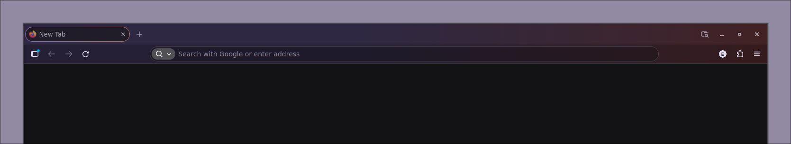

# minimal-firefox-chrome
A minimal Firefox UI without useless buttons or icons; using keyboard shortcuts allows for more screen space and workspace clarity.

### before

### after

  

## Installation
1. Download `userChrome.css`
2. Type `about:profiles` in the Firefox address bar to access profile settings.
3. Go to the Root Directory of your profile (e.g., `.../.mozilla/firefox/xxxxxxxx.default`).
4. Navigate to the chrome/ folder (if it doesn't exist, create it)
5. Copy the downloaded userChrome.css into that folder
6. Go to `about:config`, search for `toolkit.legacyUserProfileCustomizations.stylesheets`, and set it to true.

## Customise css
I chose to remove buttons that seemed unnecessary for my purposes (since I use keyboard shortcuts or the `about:` in url). The CSS is commented, so you can easily restore elements or customize them however you like.

## Firefox Theme Compatible
`userChrome.css` do not change any colors; this way, all classic Firefox themes will work with it